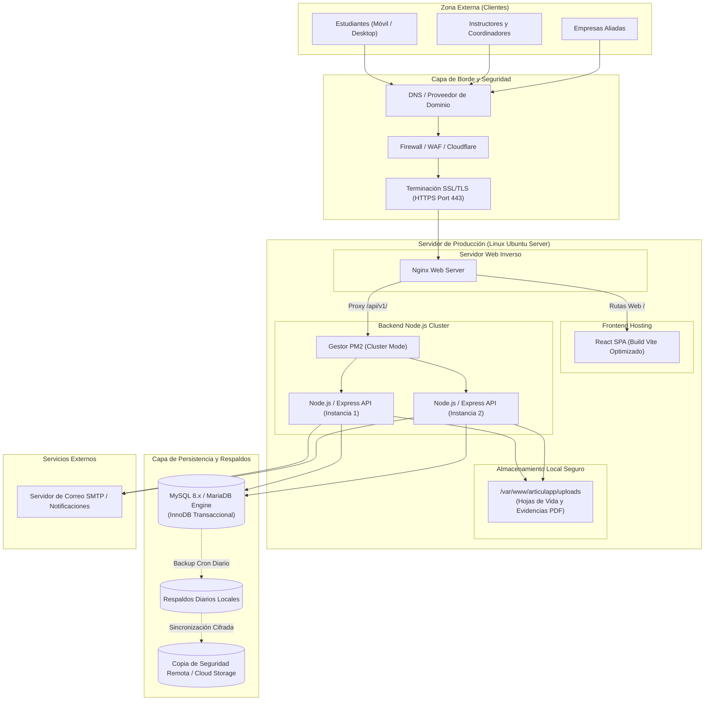

# Documento de Análisis de Infraestructura, Requerimientos Técnicos y Plan de Puesta en Marcha

**Proyecto:** ArticulApp - Sistema de Gestión y Articulación con la Educación Media Técnica  
**Versión:** 1.0.0  
**Fecha:** Septiembre 2026  
**Elaborado por:** Equipo de Ingeniería y Desarrollo de Software  
**Destinatario:** Dirección Institucional, Área de Infraestructura y Tecnología (TI) del Cliente  
**Estado:** Propuesta Técnica de Aprovisionamiento y Puesta en Marcha

---

## 1. Introducción y Propósito del Documento

El presente documento constituye el levantamiento técnico, investigación y dimensionamiento de la infraestructura tecnológica requerida para el despliegue, operación continua, escalabilidad y seguridad de la plataforma **ArticulApp (Instituto Estudiantil)**.

Asimismo, formaliza la solicitud de requerimientos e insumos de infraestructura que la institución cliente debe proveer para dar inicio formal a la fase de **Puesta en Marcha (*Go-Live*)**.

---

## 2. Objetivos del Levantamiento de Infraestructura

### 2.1 Objetivo General
Definir y documentar las especificaciones de hardware, software, red, seguridad y contingencia necesarias para desplegar y operar de manera óptima el ecosistema **ArticulApp** en entorno de producción.

### 2.2 Objetivos Específicos
1. **Simular y estimar la carga transaccional** y volumen de concurrencia de usuarios (estudiantes, instructores, coordinadores y empresas vinculadas).
2. **Dimensionar las capacidades de cómputo, memoria y almacenamiento** requeridas para el servidor de aplicaciones, la base de datos y el repositorio de archivos adjuntos.
3. **Establecer la topología de red y protocolos de seguridad** (firewall, certificados SSL/TLS, DNS, proxies inversos).
4. **Presentar el requerimiento formal al cliente** con el cronograma, matriz RACI y lista de verificación (*checklist*) para la entrega de la infraestructura.

---

## 3. Simulación e Investigación de Cargas y Dimensionamiento

Para determinar la infraestructura óptima, el equipo técnico realizó una simulación basada en la población objetivo del sistema de articulación institucional:

### 3.1 Población de Usuarios y Perfiles Estimados
* **Colegios / Sedes Articuladas:** 5 a 15 instituciones educativas.
* **Estudiantes Registrados (Grados 10° y 11°):** ~1,500 a 3,000 estudiantes activos.
* **Instructores / Evaluadores SENA:** 30 a 60 instructores técnicos.
* **Empresas Aliadas y Reclutadores:** 50 a 100 empresas con ofertas de prácticas y empleo.
* **Administradores / Coordinadores Académicos:** 5 a 10 usuarios de gestión central.

### 3.2 Patrones de Tráfico y Simulación de Carga
```text
+-----------------------------------------------------------------------------------+
| Escenario           | Usuarios Concurrentes | Peticiones/seg (RPS) | Ancho de Banda |
+---------------------+-----------------------+----------------------+----------------+
| Operación Normal    | 80 - 150 usuarios     | 25 - 50 req/s        | 5 - 10 Mbps    |
| Cierre de Periodo   | 400 - 800 usuarios    | 150 - 300 req/s      | 25 - 50 Mbps   |
| Convocatoria Empleo | 300 - 600 usuarios    | 100 - 200 req/s      | 20 - 40 Mbps   |
+---------------------+-----------------------+----------------------+----------------+
```

* **Operación Normal:** Consultas de estado de competencias, registro de avances pedagógicos y navegación del catálogo de ofertas.
* **Pico - Cierre de Periodo Académico:** Registro masivo y simultáneo de juicios evaluativos (Aprobado / No Aprobado) por parte de instructores y consulta masiva de calificaciones por estudiantes.
* **Pico - Convocatorias Laborales:** Carga masiva de Hojas de Vida (PDF) y postulaciones a vacantes empresariales.

### 3.3 Estimación de Almacenamiento y Crecimiento Anual
* **Base de Datos Relacional (MySQL / MariaDB):** ~2 GB a 5 GB anuales (registros de usuarios, auditoría, bitácora de evaluaciones y logs).
* **Almacenamiento de Archivos (Hojas de Vida, Evidencias, Certificados PDF):**
  * Tamaño promedio por PDF: 1.5 MB.
  * 3,000 estudiantes x 2 versiones de HV/Evidencias = 9 GB iniciales.
  * Crecimiento proyectado: **20 GB a 50 GB anuales**.

---

## 4. Topología y Arquitectura de Infraestructura

El sistema utiliza una arquitectura cliente-servidor desacoplada (*Three-Tier Architecture*). La siguiente topología representa la distribución física y lógica recomendada:



---

## 5. Matriz de Requerimientos Técnicos

### 5.1 Especificaciones de Hardware del Servidor (On-Premise o Cloud VPS)

| Componente | Requisito Mínimo (Piloto / 500 Usuarios) | Requisito Recomendado (Producción / Escala Completa) |
| :--- | :--- | :--- |
| **Procesador (CPU)** | 2 vCPUs (2.4 GHz o superior) | **4 a 8 vCPUs** (Arquitectura x86_64 moderna) |
| **Memoria RAM** | 4 GB DDR4 | **8 GB a 16 GB RAM** |
| **Almacenamiento** | 80 GB SSD | **160 GB a 256 GB NVMe SSD** (Alta velocidad IOPS) |
| **Arquitectura** | 64 bits | 64 bits |
| **Conexión de Red** | 100 Mbps simétricos | **1 Gbps dedicado** |
| **Disponibilidad Eléctrica** | N/A (Cloud) o UPS 1 kVA (On-Premise) | Redundancia eléctrica / Tier III Datacenter |

### 5.2 Requisitos de Software y Sistema Operativo

| Capa | Especificación Técnica | Justificación |
| :--- | :--- | :--- |
| **Sistema Operativo** | **Ubuntu Server 22.04 LTS o 24.04 LTS** (64 bits) | Soporte a largo plazo, estabilidad y seguridad comprobada. |
| **Runtime Backend** | **Node.js v20.x LTS o v22.x LTS** | Motor de ejecución JavaScript con soporte de librerías nativas. |
| **Gestor de Procesos** | **PM2 v5.x** | Monitoreo, reinicio automático en fallos, balanceo de carga en cluster. |
| **Servidor Web / Proxy** | **Nginx v1.24+** | Proxy inverso de alto rendimiento, compresión Gzip/Brotli, cabeceras HTTP de seguridad. |
| **Base de Datos** | **MySQL Server 8.0.x** o **MariaDB 10.11+** | Motor relacional InnoDB con soporte transaccional ACID estricto. |
| **Seguridad SSL/TLS** | **Certificado SSL/TLS válido** (Let's Encrypt o Comercial) | Cifrado obligatorio HTTPS para datos sensibles de estudiantes y credenciales. |
| **Gestión de Paquetes** | **npm v10.x** / **git** | Despliegues continuos y actualización de librerías. |

### 5.3 Requisitos de Red y Conectividad

1. **Dirección IP Pública Estática:** Asignada al servidor o al balanceador/firewall del cliente.
2. **Nombre de Dominio / Subdominio (FQDN):** Por ejemplo: `articulacion.institucion.edu.co` o `articulapp.edu.co`.
3. **Apertura de Puertos en Firewall / DMZ:**
   * **Puerto 80 (TCP - HTTP):** Abierto a Internet (redirección 301 obligatoria a HTTPS).
   * **Puerto 443 (TCP - HTTPS):** Abierto a Internet (tráfico cifrado de producción).
   * **Puerto 22 (TCP - SSH):** Restringido estrictamente a las IPs públicas del equipo de administración/soporte o mediante VPN institucional.
   * **Puerto 3306 (TCP - MySQL):** **Bloqueado para acceso externo**. Solo accesible internamente (`127.0.0.1` / `localhost`).
4. **Servicio de Envío de Correos (SMTP):**
   * Servidor SMTP corporativo (puerto 587 con STARTTLS o 465 con SSL) con credenciales de remitente para el envío de notificaciones, confirmaciones de registro y restablecimiento de contraseñas.

### 5.4 Requerimientos del Entorno Cliente (Estaciones de Trabajo de Usuarios)

Para los usuarios que interactúan con la plataforma (estudiantes, docentes, coordinadores y empresas):

* **Dispositivos Soportados:** Computadores de escritorio, portátiles, tablets y teléfonos inteligentes.
* **Navegadores Web Compatibles:**
  * Google Chrome v100+ (Recomendado).
  * Mozilla Firefox v100+.
  * Microsoft Edge v100+.
  * Safari v15+.
* **Resolución de Pantalla Mínima:** 1024 x 768 píxeles (Diseño responsivo optimizado para móviles y pantallas panorámicas).
* **Conectividad a Internet:** Mínimo 2 Mbps por usuario activo para carga fluida de interfaces y documentos.

---

## 6. Políticas de Seguridad, Respaldo y Contingencia

### 6.1 Política de Respaldos de Base de Datos y Archivos
* **Copias de Seguridad Diarias:** Tarea cron automatizada a las 02:00 AM (volcado completo con `mysqldump` comprimido y cifrado con GPG).
* **Retención:**
  * 7 respaldos diarios.
  * 4 respaldos semanales.
  * 12 respaldos mensuales.
* **Almacenamiento Fuera de Sitio (*Off-site*):** Sincronización diaria del archivo de respaldo hacia un almacenamiento secundario seguro (AWS S3, Google Cloud Storage o servidor NAS secundario de la institución).

### 6.2 Plan de Continuidad y Recuperación ante Desastres (DRP)
* **RPO (*Recovery Point Objective*):** Máximo 24 horas de pérdida de datos en caso de catástrofe total.
* **RTO (*Recovery Time Objective*):** Máximo 2 horas para restauración completa del servicio en un nuevo nodo a partir de las imágenes y scripts automatizados.

### 6.3 Seguridad y Protección de Datos Personales
* **Cifrado en Tránsito:** TLS 1.3 con suites de cifrado seguras (*A+ rating en SSL Labs*).
* **Cifrado en Reposo de Contraseñas:** Algoritmo de derivación de claves `bcrypt` con factor de coste de 10 rondas.
* **Protección contra Ataques:**
  * Mitigación de inyección SQL mediante consultas parametrizadas preparadas.
  * Mitigación XSS y CSRF mediante cabeceras HTTP seguras (*Content-Security-Policy, HSTS, X-Frame-Options*).
  * Rate Limiting por IP para prevenir ataques de fuerza bruta en endpoints de autenticación (`/api/v1/auth/login`).
  * Validación estricta de extensiones y tipos MIME en archivos PDF subidos para evitar inyección de malware.

---

## 7. Matriz de Responsabilidades de Despliegue (Matriz RACI)

| Actividad / Hito | Equipo de Desarrollo | Área TI / Infraestructura Cliente | Dirección / Coordinación Cliente |
| :--- | :---: | :---: | :---: |
| Aprovisionamiento de Servidor (VPS / On-Premise) | Consultor (C) | **Responsable (R)** | Aprobador (A) |
| Asignación de IP Pública y Configuración de DNS | Informado (I) | **Responsable (R)** | Aprobador (A) |
| Apertura de Puertos de Firewall y Políticas de Red | Consultor (C) | **Responsable (R)** | Informado (I) |
| Entrega de Credenciales SMTP Institucionales | Informado (I) | **Responsable (R)** | Informado (I) |
| Instalación de Dependencias Base (Node, Nginx, MySQL) | **Responsable (R)** | Acompañante (C) | Informado (I) |
| Despliegue de Código Fuente y Migración de Base de Datos | **Responsable (R)** | Informado (I) | Informado (I) |
| Configuración de Certificados SSL/TLS | **Responsable (R)** | Soporte (C) | Informado (I) |
| Ejecución de Pruebas de Carga y Seguridad en Staging | **Responsable (R)** | Verificador (C) | Informado (I) |
| Pruebas de Aceptación de Usuario (UAT) | Soporte (C) | Informado (I) | **Responsable (R)** |
| Firma del Acta de Puesta en Marcha (*Go-Live*) | Acompañante (C) | Aprobador (A) | **Responsable (R)** |

*(R: Responsable de ejecución, A: Aprobador final, C: Consultado / Apoyo técnico, I: Informado)*

---

## 8. Solicitud Formal de Requerimiento al Cliente para la Puesta en Marcha

---

**CIUDAD Y FECHA:** Bogotá D.C. / Medellín, Septiembre de 2026  
**DE:** Equipo Líder del Proyecto de Ingeniería ArticulApp  
**PARA:** Dirección de Tecnología e Infraestructura / Comité de Articulación Institucional  
**ASUNTO:** Solicitud Formal de Insumos de Infraestructura y Cronograma de Puesta en Marcha del Sistema **ArticulApp**

Estimados directivos y equipo técnico,

Por medio de la presente, nos dirigimos a ustedes con el propósito de notificar la culminación satisfactoria de las fases de desarrollo, pruebas unitarias y validación funcional del sistema **ArticulApp (Plataforma de Gestión y Articulación con la Educación Media Técnica)**.

Con el fin de proceder con el despliegue del aplicativo en su entorno de producción y garantizar un lanzamiento estable, seguro y de alta disponibilidad, solicitamos formalmente el suministro de los siguientes insumos técnicos y accesos antes del inicio de la ventana de instalación:

### 8.1 Lista de Verificación de Insumos Requeridos (*Checklist*)

- [ ] **1. Servidor Dedicado o Instancia Cloud Aprovisionada:**
  - Sistema Operativo: Ubuntu Server 22.04 / 24.04 LTS con acceso `sudo` / SSH.
  - Especificaciones mínimas: 4 vCPUs, 8 GB RAM, 100 GB SSD NVMe.
- [ ] **2. Conectividad y Direccionamiento:**
  - IP Pública Fija asignada.
  - Dominio o subdominio configurado en registros DNS tipo A apuntando a la IP pública (ej: `articulapp.institucion.edu.co`).
- [ ] **3. Reglas de Firewall:**
  - Puertos 80 (HTTP) y 443 (HTTPS) con tráfico entrante y saliente habilitado hacia Internet.
  - Puerto 22 (SSH) habilitado para las direcciones IP autorizadas del equipo de despliegue.
- [ ] **4. Servicio de Correo Electrónico Institucional (SMTP):**
  - Servidor SMTP Host, Puerto, Usuario (email remitente) y Contraseña/App Password para el despacho de correos automáticos.
- [ ] **5. Ventana de Mantenimiento / Despliegue Aprobada:**
  - Autorización de fecha y hora para la ejecución del despliegue inicial y pruebas finales en vivo.

### 8.2 Cronograma Propuesto para la Puesta en Marcha

| Fase / Hito | Duración Estimada | Actividades Principales |
| :--- | :--- | :--- |
| **Hito 1: Entrega de Infraestructura** | Día 1 | Verificación de accesos al servidor, validación de DNS y conectividad. |
| **Hito 2: Aprovisionamiento de Servidor** | Día 2 | Endurecimiento (*hardening*) de SO, instalación de Nginx, MySQL, Node.js y certificados SSL. |
| **Hito 3: Despliegue y Migración** | Día 3 | Carga del backend compilado, frontend estático, ejecución de migraciones de tablas y datos semilla iniciales. |
| **Hito 4: Pruebas de Integración y Humo (*Smoke Tests*)** | Día 4 | Pruebas de inicio de sesión de roles, subida de archivos, emisión de juicios y envío de correos. |
| **Hito 5: Capacitación a Administradores** | Día 5 | Entrega de manuales técnicos, inducción de administración y políticas de respaldo. |
| **Hito 6: Salida a Producción (*Go-Live*)** | Día 6 | Apertura formal a directores, instructores, colegios articulados y estudiantes. |

Agradecemos de antemano su colaboración y pronta gestión de estos requerimientos para dar inicio exitoso a la puesta en marcha de esta solución tecnológica en beneficio de la comunidad educativa.

Atentamente,

```text
_________________________________________
EQUIPO DE DESARROLLO E INGENIERÍA ARTICULAPP
Proyecto de Articulación con la Educación Media Técnica

_________________________________________
RECIBIDO Y APROBADO POR:
Área de Infraestructura y TI / Dirección Institucional
Fecha de Aprobación: _____ / _____ / 2026
```