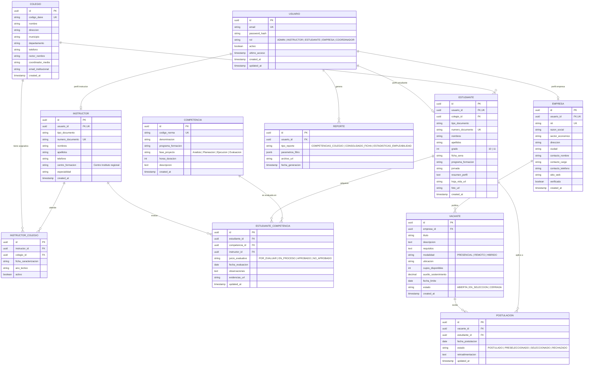

# Instituto Estudiantil - Documentación Técnica y Arquitectura de Software
**Proyecto Formativo:** Sistema de Gestión y Articulación con la Educación Media Técnica (Grados 10° y 11°)  
**Programa:** Tecnólogo en Análisis y Desarrollo de Software (ADSO) / ADSI  
**Versión:** 1.0.0  
**Fecha:** Septiembre 2026  

---

## 1. Diagrama Entidad-Relación (ERD)

### 1.1 Modelo Entidad-Relación en Mermaid



### 1.2 Diccionario de Datos y Reglas de Cardinalidad

1. **Usuario y Perfiles Especializados (1:1 opcional):**
   - Un `USUARIO` posee exactamente un registro específico según su rol (`ESTUDIANTE`, `INSTRUCTOR` o `EMPRESA`). Si el rol es `ADMIN` o `COORDINADOR`, opera directamente desde la entidad base de autenticación o mediante flags de privilegios.
   - Cardinalidad: `USUARIO (1) <---> (0..1) PERFIL`.

2. **Colegio y Estudiantes (1:N):**
   - Un `COLEGIO` matricula a muchos `ESTUDIANTE`s de educación media técnica.
   - Cada `ESTUDIANTE` pertenece a un único `COLEGIO` articulado en el año lectivo.
   - Cardinalidad: `COLEGIO (1) <---> (0..N) ESTUDIANTE`.

3. **Asignación Colegio - Instructor (N:M a través de INSTRUCTOR_COLEGIO):**
   - Un `INSTRUCTOR` Instituto puede estar asignado a varios colegios articulados o fichas en una regional.
   - Un `COLEGIO` puede contar con varios instructores de distintas áreas técnicas.
   - Cardinalidad: `INSTRUCTOR (1) <---> (0..N) INSTRUCTOR_COLEGIO (N..0) <---> (1) COLEGIO`.

4. **Evaluación de Competencias (N:M con atributos de auditoría):**
   - Un `ESTUDIANTE` cursa múltiples `COMPETENCIA`s del programa Instituto.
   - Una `COMPETENCIA` es evaluada en múltiples estudiantes.
   - La tabla pivote `ESTUDIANTE_COMPETENCIA` almacena el juicio evaluativo Instituto (`APROBADO`, `EN_PROCESO`, `NO_APROBADO`), el `INSTRUCTOR` firmante, evidencias y observaciones pedagógicas.
   - Restricción de unicidad: `UNIQUE(estudiante_id, competencia_id)`.

5. **Vacantes y Postulaciones (1:N y N:M):**
   - Una `EMPRESA` publica muchas `VACANTE`s para etapas de patrocinio o prácticas de media técnica.
   - Una `VACANTE` recibe múltiples `POSTULACION`es.
   - Un `ESTUDIANTE` puede postularse a varias vacantes (con validación de negocio de cumplimiento mínimo de competencias).
   - Restricción: `UNIQUE(vacante_id, estudiante_id)`.

---

## 2. Diseño de Arquitectura del Sistema

### 2.1 Visión General de la Arquitectura
Se implementa una **Arquitectura Cliente-Servidor Desacoplada** de tres niveles lógicos (*Three-Tier Architecture*), comunicada mediante un protocolo **RESTful API** sobre HTTPS y transporte JSON.

```
┌─────────────────────────────────────────────────────────────┐
│                    CLIENTE (Frontend SPA)                   │
│         React.js + Vite + Tailwind CSS / Vanilla CSS        │
│    [Context API / AuthState] ─── [Axios Interceptors]       │
└──────────────────────────────┬──────────────────────────────┘
                               │ HTTPS / JSON (Bearer JWT)
                               ▼
┌─────────────────────────────────────────────────────────────┐
│                   BACKEND (Node.js + Express)               │
│                                                             │
│  ┌───────────────────────────────────────────────────────┐  │
│  │ 1. Middleware Layer: CORS, Helmet, RateLimit, JWT RBAC│  │
│  └───────────────────────────┬───────────────────────────┘  │
│                              ▼                              │
│  ┌───────────────────────────────────────────────────────┐  │
│  │ 2. Routing & Controller Layer (Express Routers)       │  │
│  └───────────────────────────┬───────────────────────────┘  │
│                              ▼                              │
│  ┌───────────────────────────────────────────────────────┐  │
│  │ 3. Business Logic & Service Layer (Validaciones, RAPs)│  │
│  └───────────────────────────┬───────────────────────────┘  │
│                              ▼                              │
│  ┌───────────────────────────────────────────────────────┐  │
│  │ 4. Data Access Layer / Pool (mysql2 / InnoDB SQL)     │  │
│  └───────────────────────────┬───────────────────────────┘  │
└──────────────────────────────┼──────────────────────────────┘
                               │ TCP / SSL Connection Pool
                               ▼
┌─────────────────────────────────────────────────────────────┐
│           PERSISTENCIA (MySQL 8.x / MariaDB / Cloud)        │
│    Tablas Relacionales, Índices B-Tree, Motor InnoDB        │
└─────────────────────────────────────────────────────────────┘
```

### 2.2 Desglose por Capas del Backend

1. **Capa de Enrutamiento y Middlewares (`/routes` & `/middlewares`):**
   - *Autenticación y Autorización:* Valida tokens JWT en cabeceras `Authorization: Bearer <token>`. Decodifica `sub`, `rol` y verifica si el usuario se encuentra activo.
   - *Control de Acceso Basado en Roles (RBAC):* Middleware parametrizable `authorizeRoles('INSTRUCTOR', 'ADMIN')`.
   - *Validación de Esquema:* Valida payloads antes de ingresar al controlador.
   - *Seguridad:* Implementación de `helmet` para cabeceras HTTP seguras, `cors` con lista blanca de orígenes y protección de endpoints sensibles.

2. **Capa de Controladores (`/controllers`):**
   - Extrae parámetros de la petición (`req.params`, `req.query`, `req.body`).
   - Invoca a los servicios o capas de acceso a datos correspondientes.
   - Retorna respuestas normalizadas bajo el estándar JSend:
     ```json
     {
       "status": "success",
       "data": { ... },
       "message": "Operación ejecutada correctamente"
     }
     ```
   - Manejo centralizado de excepciones HTTP con códigos de estado semánticos (200, 201, 400, 401, 403, 404, 422, 500).

3. **Capa de Lógica de Negocio / Servicios (`/services`):**
   - Contiene las reglas operativas Instituto:
     - Cálculo de porcentaje de avance formativo del aprendiz.
     - Restricción de postulación: Un aprendiz solo puede postularse si cuenta con al menos el 70% de competencias aprobadas.
     - Obligatoriedad de plan de mejoramiento en observaciones pedagógicas para juicios "No Aprobado".
     - Generación de reportes tabulares y sábanas académicas.

4. **Capa de Datos y Repositorios (`/config/db.js` y modelos):**
   - Conexión a base de datos relacional con `mysql2/promise` (Connection Pool de alta concurrencia).
   - Motor relacional **InnoDB** con soporte de transacciones ACID (`START TRANSACTION`, `COMMIT`, `ROLLBACK`) para garantizar consistencia en la matrícula y asentamiento de juicios.

### 2.3 Seguridad y Gestión de Sesión
- **Algoritmo JWT:** `HS256` con secreto criptográfico almacenado en variable de entorno `JWT_SECRET`.
- **Expiración:** Tokens de acceso con vida útil corta (2 horas).
- **Almacenamiento de contraseñas:** Algoritmo `bcryptjs` con factor de coste de 10-12 salt rounds.

### 2.4 Entorno de Infraestructura y Despliegue
- **Frontend:** Render Static Site / Vercel / Railway (Build en Vite dist).
- **Backend:** Railway / Render Web Service corriendo Node.js 24 LTS con reinicio automático.
- **Base de Datos:** MySQL 8.x administrado (XAMPP local / Railway MySQL / PlanetScale / Aiven) con charset `utf8mb4` y respaldos automáticos.

---

## 3. Especificación de Endpoints de la API REST

### 3.1 Módulo 1: Autenticación y Gestión de Usuarios (`/api/v1/auth`, `/api/v1/users`)

| Método | Endpoint | Roles Permitidos | Descripción | Payload Entrada (Resumen) | Respuesta Exitosa |
| :--- | :--- | :--- | :--- | :--- | :--- |
| `POST` | `/api/v1/auth/login` | Público | Autentica usuario y expide token JWT | `{ "email": "inst@sena.edu.co", "password": "***" }` | `200 OK` `{ token, usuario, perfil }` |
| `POST` | `/api/v1/auth/register-empresa` | Público | Registro autónomo de empresa aliada | `{ email, password, nit, razon_social, ... }` | `201 Created` `{ empresa_id, status }` |
| `GET` | `/api/v1/auth/me` | Autenticado | Retorna sesión y perfil del usuario actual | Header `Authorization: Bearer <token>` | `200 OK` `{ id, email, rol, perfil }` |
| `POST` | `/api/v1/auth/recuperar-password` | Público | Solicita token temporal de reseteo | `{ "email": "alumno@colegio.edu.co" }` | `200 OK` `{ message: "Enlace enviado" }` |
| `GET` | `/api/v1/users` | `ADMIN` | Lista usuarios con paginación y filtros | Query: `?rol=ESTUDIANTE&page=1&limit=20` | `200 OK` `{ total, items: [...] }` |
| `PATCH`| `/api/v1/users/:id/estado` | `ADMIN` | Activa o suspende una cuenta de usuario | `{ "activo": false, "motivo": "Graduado" }` | `200 OK` `{ id, activo: false }` |

### 3.2 Módulo 2: Articulación Colegio - Instituto (`/api/v1/colegios`, `/api/v1/fichas`)

| Método | Endpoint | Roles Permitidos | Descripción |
| :--- | :--- | :--- | :--- |
| `GET` | `/api/v1/colegios` | `ADMIN`, `INSTRUCTOR` | Listado de colegios articulados y estado de convenio |
| `POST` | `/api/v1/colegios` | `ADMIN` | Registra una nueva institución de educación media |
| `GET` | `/api/v1/colegios/:id/estudiantes` | `ADMIN`, `INSTRUCTOR`, `COORDINADOR` | Estudiantes vinculados al colegio filtrados por grado (10° / 11°) |
| `POST` | `/api/v1/colegios/:id/asignar-instructor` | `ADMIN` | Asigna un instructor Instituto a un colegio y ficha específica |
| `GET` | `/api/v1/colegios/:id/estadisticas` | `ADMIN`, `INSTRUCTOR`, `COORDINADOR` | Resumen de aprendices matriculados vs en etapa productiva |

### 3.3 Módulo 3: Seguimiento y Evaluación de Competencias (`/api/v1/competencias`, `/api/v1/evaluacion`)

| Método | Endpoint | Roles Permitidos | Descripción | Payload / Parámetros |
| :--- | :--- | :--- | :--- | :--- |
| `GET` | `/api/v1/competencias` | Autenticado | Catálogo de competencias del programa de formación Instituto | Query: `?programa=ADSO` |
| `POST` | `/api/v1/competencias` | `ADMIN` | Crear nueva competencia según diseño curricular | `{ codigo_norma, denominacion, horas, fase }` |
| `GET` | `/api/v1/evaluacion/estudiante/:estudianteId` | `INSTRUCTOR`, `ADMIN`, `ESTUDIANTE` | Consulta la sábana de competencias del aprendiz | Param: `estudianteId` |
| `PUT` | `/api/v1/evaluacion/calificar-individual` | `INSTRUCTOR` | Asienta juicio evaluativo individual | `{ estudiante_id, competencia_id, juicio: "APROBADO", observaciones }` |
| `POST` | `/api/v1/evaluacion/calificar-masivo` | `INSTRUCTOR` | Califica una competencia para toda la ficha en bloque | `{ ficha_sena, competencia_id, estudiantes: [{ id, juicio }] }` |
| `GET` | `/api/v1/evaluacion/matriz-ficha/:ficha` | `INSTRUCTOR`, `COORDINADOR` | Retorna matriz de semaforización (Aprobados, En proceso, Pendientes) | Param: `ficha` |

### 3.4 Módulo 4: Perfil Digital del Estudiante (`/api/v1/estudiantes/perfil`)

| Método | Endpoint | Roles Permitidos | Descripción |
| :--- | :--- | :--- | :--- |
| `GET` | `/api/v1/estudiantes/mi-perfil` | `ESTUDIANTE` | Consulta datos personales, colegio, ficha y competencias alcanzadas |
| `PUT` | `/api/v1/estudiantes/mi-perfil` | `ESTUDIANTE` | Actualiza resumen profesional, habilidades blandas, teléfono y foto |
| `POST` | `/api/v1/estudiantes/mi-perfil/hoja-de-vida` | `ESTUDIANTE` | Sube archivo PDF de Hoja de Vida / Formato Instituto (Multer) |
| `GET` | `/api/v1/estudiantes/:id/insignias-digitales` | Autenticado | Retorna micro-credenciales y competencias Instituto validadas para consulta pública |

### 3.5 Módulo 5: Vacantes Empresariales y Postulaciones (`/api/v1/vacantes`, `/api/v1/postulaciones`)

| Método | Endpoint | Roles Permitidos | Descripción | Regla de Negocio / Payload |
| :--- | :--- | :--- | :--- | :--- |
| `POST` | `/api/v1/vacantes` | `EMPRESA` | Publica vacante de práctica/patrocinio | `{ titulo, requisitos, cupos, auxilio, modalidad, fecha_limite }` |
| `GET` | `/api/v1/vacantes` | `ESTUDIANTE`, `ADMIN` | Explora vacantes abiertas con filtros | Query: `?modalidad=REMOTO&sector=TECNOLOGIA` |
| `GET` | `/api/v1/vacantes/mis-vacantes` | `EMPRESA` | Lista de vacantes publicadas por la empresa autenticada | Retorna métricas de postulados por vacante |
| `POST` | `/api/v1/vacantes/:id/postularme` | `ESTUDIANTE` | Postulación del aprendiz a una oferta | Valida que el aprendiz tenga >= 70% de competencias aprobadas |
| `GET` | `/api/v1/vacantes/:id/postulados` | `EMPRESA` | Lista aprendices postulados con acceso a su perfil digital | Muestra badges de competencias aprobadas |
| `PATCH`| `/api/v1/postulaciones/:id/estado` | `EMPRESA` | Actualiza estado: Preseleccionado, Aceptado, Rechazado | `{ "estado": "PRESELECCIONADO", "retroalimentacion": "Llamar a entrevista" }` |

### 3.6 Módulo 6: Reportes y Estadísticas (`/api/v1/reportes`)

| Método | Endpoint | Roles Permitidos | Descripción |
| :--- | :--- | :--- | :--- |
| `GET` | `/api/v1/reportes/progreso-colegios` | `ADMIN`, `INSTRUCTOR` | Métrica consolidada de % de aprobación por colegio y grado |
| `GET` | `/api/v1/reportes/tasa-colocacion` | `ADMIN`, `COORDINADOR` | Porcentaje de estudiantes ubicados en empresas aliadas |
| `POST` | `/api/v1/reportes/descargar-excel` | `ADMIN`, `INSTRUCTOR` | Genera y descarga sábana académica en formato Excel (.xlsx) |

---

## 4. Wireframes Descritos en Texto (Pantallas Clave)

### 4.1 Pantalla 1: Login y Selección de Portal (Acceso Unificado)
* **Objetivo:** Autenticar de manera segura a los cuatro perfiles del ecosistema Instituto Estudiantil.
* **Layout:**
  - **Lado Izquierdo (40% desktop):** Banner ilustrativo con identidad institucional Instituto, escudo, lema: *"Conectando el talento de la Educación Media Técnica con las oportunidades productivas de Colombia"*. Indicador de articulación Grados 10° y 11°.
  - **Lado Derecho (60% desktop):**
    - Logo oficial de **Instituto Estudiantil**.
    - Selector rápido de rol o bienvenida contextual: *"Ingresa con tu cuenta institucional Instituto o empresarial"*.
    - Formulario:
      - Campo 1: Correo electrónico (`input type="email"` con placeholder `ejemplo@instituto.edu.co` / `contacto@empresa.com`).
      - Campo 2: Contraseña (`input type="password"` con toggle de visualización "Mostrar/Ocultar").
      - Enlace: *"¿Olvidaste tu contraseña?"* (lleva a flujo de recuperación).
      - Botón Principal: `[ Iniciar Sesión ]` (Verde institucional `#39A900`, texto blanco, micro-animación de carga).
      - Separador: *"¿Eres una empresa nueva interesada en talento joven?"* -> Botón Secundario Outline `[ Registrar Empresa ]`.
    - Footer inferior: Términos de tratamiento de datos personales conforme a la Ley 1581 de 2012 de Colombia.

### 4.2 Pantalla 2: Panel del Instructor Instituto (Seguimiento de Competencias)
* **Objetivo:** Permitir al instructor visualizar sus colegios asignados, calificar RAPs y emitir juicios evaluativos.
* **Layout:**
  - **Barra Superior (TopBar):** Logo Instituto Estudiantil, selector de año lectivo actual (2026), notificaciones, avatar del instructor con nombre y centro de formación.
  - **Sidebar Lateral Izquierda:**
    - Inicio / Dashboard
    - Mis Colegios y Fichas (Badge con número de fichas activas)
    - Matriz de Competencias
    - Reportes de Juicios Evaluativos
    - Cerrar Sesión
  - **Área Central (Main Content):**
    1. *Header de Ficha:* Título: `I.E. Técnico San José - Ficha 2712345 (Grado 11° - Técnico en Sistemas)`.
    2. *Tarjetas KPI superiores:*
       - Tarjeta 1: Total Aprendices (ej. 32).
       - Tarjeta 2: Competencias Vistas (ej. 6 de 8).
       - Tarjeta 3: % Aprobación General (ej. 84% con barra de progreso verde).
       - Tarjeta 4: Alumnos en Riesgo Académico (ej. 3 alumnos con alertas).
    3. *Barra de Filtros y Acciones:*
       - Dropdown de Competencia: `[ 220501096 - Desarrollar la estructura de datos... v ]`.
       - Buscador rápido por nombre o número de documento del aprendiz.
       - Botón: `[ Calificación Masiva ]` y `[ Exportar Sábana Excel ]`.
    4. *Tabla de Evaluación Dinámica:*
       - Columnas: Documento | Nombres y Apellidos | Evidencias Entregadas (Link Drive/PDF) | Juicio Evaluativo (Selector: `Aprobado` [Verde], `En Proceso` [Amarillo], `No Aprobado` [Rojo]) | Observaciones (Input editable en línea) | Acción `[ Guardar ]`.

### 4.3 Pantalla 3: Perfil Digital del Estudiante (Portafolio de Habilidades Instituto)
* **Objetivo:** Servir como carta de presentación digital homologada del aprendiz ante empresas patrocinadoras.
* **Layout:**
  - **Cabecera del Perfil (Hero Section):**
    - Foto de perfil con marco circular y badge oficial *"Aprendiz Instituto Articulación Media Técnica"*.
    - Nombres completos: `Juan Camilo Rodríguez Pérez`.
    - Grado y Colegio: `Grado 11° - Instituto Técnico Industrial Piloto`.
    - Programa: `Técnico en Programación de Software (Ficha 2894110)`.
    - Botones de acción: `[ Descargar Hoja de Vida PDF ]` y `[ Compartir Perfil Público ]`.
  - **Cuerpo en Dos Columnas:**
    - **Columna Izquierda (35%):**
      - *Sobre mí:* Breve descripción profesional escrita por el estudiante.
      - *Datos de Contacto:* Municipio, correo institucional, teléfono.
      - *Habilidades Técnicas:* Badges/Tags (`JavaScript`, `React`, `PostgreSQL`, `Git`, `Lógica de Programación`).
      - *Habilidades Blandas:* `Trabajo en equipo`, `Resolución de problemas`, `Puntualidad`.
    - **Columna Derecha (65%):**
      - *Radar de Competencias Instituto Adquiridas (Insignias Validadas):*
        - Lista de tarjetas con código de norma, nombre oficial de la competencia, fecha de aprobación y nombre del instructor que emitió el juicio.
        - Barra de progreso global del programa: `75% Completado - Apto para Etapa Productiva`.
      - *Portafolio de Proyectos Formativos:*
        - Card de Proyecto: Nombre del aplicativo desarrollado en el colegio, tecnologías utilizadas, enlace a repositorio GitHub y demo funcional.
      - *Pestaña "Mis Postulaciones":*
        - Historial de ofertas a las que ha aplicado y estado actual (`En revisión`, `Preseleccionado`, etc.).

### 4.4 Pantalla 4: Panel de la Empresa (Gestión de Vacantes y Búsqueda de Talento)
* **Objetivo:** Permitir a los empresarios publicar ofertas de etapa práctica, revisar postulados y filtrar candidatos por competencias.
* **Layout:**
  - **Barra Superior:** Nombre de la empresa (`Innovatech Soluciones S.A.S.`), badge de *"Empresa Verificada Instituto"*, botón rápido `[ + Nueva Vacante ]`.
  - **Navegación por Pestañas:**
    - `[ Mis Vacantes Activas ]` | `[ Candidatos Postulados ]` | `[ Explorador de Talentos ]`.
  - **Contenido - Vista "Candidatos Postulados":**
    - *Filtros Superiores:* Vacante (`Desarrollador Junior / Practicante Frontend`), Municipio (`Bogotá / Soacha`), Nivel de Aprobación Instituto (`Mínimo 80%`).
    - *Grid de Tarjetas de Candidatos (Estilo Kanban o Tarjetas):*
      - Cada tarjeta muestra: Foto del aprendiz, Nombre, Colegio de procedencia, Grado (11°), Competencias clave validadas por el instructor.
      - Mini barra de progreso: *"8 de 8 competencias técnicas aprobadas"*.
      - Selector de Estado de Contratación: `[ Postulado ] -> [ En Entrevista ] -> [ Seleccionado ] -> [ Descartado ]`.
      - Botones: `[ Ver Perfil Completo ]` | `[ Contactar por Correo/WhatsApp ]`.
  - **Modal "Crear Nueva Vacante":**
    - Campos: Título del cargo, número de cupos, auxilio de sostenimiento económico ($ COP), modalidad, competencias Instituto requeridas (con autocompletado del catálogo Instituto) y fecha límite.

---

## 5. Historias de Usuario (Scrum) Priorizadas por Sprint

### Sprint 1: Fundaciones, Autenticación y Articulación Colegio-Instituto (Duración: 2 semanas)

#### HU-01: Autenticación con Roles y Control de Acceso
* **Como** usuario del sistema (Estudiante, Instructor, Empresa, Administrador),  
  **quiero** iniciar sesión con mis credenciales y recibir un token de acceso seguro,  
  **para** acceder a las funcionalidades exclusivas según mi rol.
* **Criterios de Aceptación (Gherkin):**
  - **Dado** que un usuario registrado ingresa su correo y contraseña válidos,  
    **Cuando** presiona el botón "Iniciar Sesión",  
    **Entonces** el backend responde con código `200 OK`, un token JWT válido y redirige al dashboard de su rol correspondiente.
  - **Dado** que un usuario ingresa credenciales inválidas o está inactivo,  
    **Cuando** envía la petición,  
    **Entonces** el sistema responde con error `401 Unauthorized` y muestra el mensaje: *"Credenciales incorrectas o cuenta deshabilitada"*.
* **Puntos de Historia:** 5 SP.

#### HU-02: Gestión y Parametrización de Colegios y Fichas Articuladas
* **Como** administrador o coordinador del programa de articulación,  
  **quiero** registrar instituciones educativas con sus códigos DANE y crear las fichas de caracterización Instituto,  
  **para** estructurar la base institucional de los aprendices de grados 10° y 11°.
* **Criterios de Aceptación:**
  - **Dado** un colegio con código DANE único y datos de contacto completos,  
    **Cuando** el administrador envía el formulario de registro,  
    **Entonces** el colegio queda almacenado en MySQL y visible en la lista general.
  - **Dado** un colegio registrado,  
    **Cuando** se intenta registrar nuevamente el mismo código DANE,  
    **Entonces** el sistema bloquea el duplicado retornando código `409 Conflict`.
* **Puntos de Historia:** 5 SP.

---

### Sprint 2: Catálogo y Evaluación de Competencias Técnicas (Duración: 2 semanas)

#### HU-03: Consulta y Asignación de Competencias por Programa
* **Como** instructor Instituto,  
  **quiero** consultar el catálogo oficial de competencias del programa de formación técnica articulada,  
  **para** planificar los resultados de aprendizaje que serán evaluados en el año lectivo.
* **Criterios de Aceptación:**
  - **Dado** un instructor autenticado con una ficha asignada,  
    **Cuando** accede al módulo de competencias,  
    **Entonces** visualiza el código de norma, denominación, duración en horas y fase del proyecto formativo correspondiente.
* **Puntos de Historia:** 3 SP.

#### HU-04: Asentamiento de Juicios Evaluativos (Individual y Masivo)
* **Como** instructor Instituto,  
  **quiero** calificar las competencias de los estudiantes asignando juicios de *"Aprobado"*, *"En Proceso"* o *"No Aprobado"* con observaciones pedagógicas,  
  **para** registrar de forma oficial el avance académico de la media técnica.
* **Criterios de Aceptación:**
  - **Dado** que el instructor selecciona una ficha, una competencia y un grupo de aprendices,  
    **Cuando** asienta los juicios y hace clic en "Guardar Calificaciones",  
    **Entonces** los registros en `ESTUDIANTE_COMPETENCIA` se actualizan con la fecha actual y el ID del instructor evaluador.
  - **Dado** que un aprendiz recibe juicio de "No Aprobado",  
    **Cuando** el instructor intenta guardar sin ingresar observaciones,  
    **Entonces** el sistema valida que el campo de texto de observaciones sea obligatorio indicando el plan de mejoramiento pedagógico.
* **Puntos de Historia:** 8 SP.

---

### Sprint 3: Perfil Digital del Aprendiz y Portafolio de Evidencias (Duración: 2 semanas)

#### HU-05: Construcción del Perfil Digital y Portafolio
* **Como** estudiante de grado 10° u 11°,  
  **quiero** completar mi perfil digital con foto, resumen, enlaces a proyectos y competencias alcanzadas,  
  **para** disponer de una carta de presentación profesional atractiva frente al sector empresarial.
* **Criterios de Aceptación:**
  - **Dado** un estudiante autenticado,  
    **Cuando** accede a "Mi Perfil" y actualiza sus datos de contacto y enlace a su repositorio,  
    **Entonces** la información queda persistida y visible en tiempo real.
  - **Dado** que las competencias son evaluadas por el instructor,  
    **Cuando** el estudiante ingresa a su perfil,  
    **Entonces** las competencias con juicio "Aprobado" se listan automáticamente con insignia de verificación y no pueden ser alteradas por el estudiante.
* **Puntos de Historia:** 5 SP.

---

### Sprint 4: Vinculación Empresarial, Vacantes y Postulaciones (Duración: 2 semanas)

#### HU-06: Publicación y Gestión de Vacantes para Prácticas
* **Como** empresa del sector productivo registrada en la plataforma,  
  **quiero** publicar ofertas de etapa práctica o contrato de aprendizaje especificando las competencias requeridas,  
  **para** captar aprendices de media técnica acordes a mis necesidades operativas.
* **Criterios de Aceptación:**
  - **Dado** un perfil de empresa verificado,  
    **Cuando** diligencia el formulario de vacante con fecha límite en el futuro y número de cupos mayor a cero,  
    **Entonces** la vacante se publica con estado "ABIERTA" y queda disponible en la cartelera de ofertas.
* **Puntos de Historia:** 5 SP.

#### HU-07: Postulación de Aprendices con Validación de Competencias
* **Como** estudiante de grado 11°,  
  **quiero** postularme a las vacantes de empresas aliadas,  
  **para** asegurar mi etapa productiva o patrocinio empresarial.
* **Criterios de Aceptación:**
  - **Dado** un estudiante con el 70% o más de sus competencias técnicas aprobadas,  
    **Cuando** hace clic en "Postularme" en una vacante abierta,  
    **Entonces** el sistema registra la postulación con estado "POSTULADO" y notifica a la empresa.
  - **Dado** un estudiante con menos del 70% de avance en competencias,  
    **Cuando** intenta postularse,  
    **Entonces** el sistema deshabilita la postulación y muestra una alerta: *"Aún no cumples con el porcentaje mínimo de competencias técnicas aprobadas para acceder a etapa práctica"*.
* **Puntos de Historia:** 8 SP.

---

### Sprint 5: Reportes, Analítica y Cierre de Articulación (Duración: 1-2 semanas)

#### HU-08: Generación de Reportes de Avance y Tasa de Colocación
* **Como** directivo del colegio o coordinador Instituto,  
  **quiero** generar reportes consolidados en PDF y Excel sobre el avance de competencias y número de estudiantes vinculados a empresas,  
  **para** rendir cuentas en las mesas de articulación interinstitucional y tomar decisiones pedagógicas.
* **Criterios de Aceptación:**
  - **Dado** un usuario con rol de Administrador o Instructor,  
    **Cuando** selecciona un colegio y rango de fechas y presiona "Descargar Reporte Excel",  
    **Entonces** el sistema genera un archivo descargable con formato válido `.xlsx` que contiene la relación de aprendices, RAPs y estado laboral.
* **Puntos de Historia:** 5 SP.

---

## 6. Checklist de Pruebas Funcionales por Módulo

| ID Caso | Módulo | Precondiciones | Pasos de Ejecución | Datos de Prueba | Resultado Esperado | Criterio de Éxito |
| :--- | :--- | :--- | :--- | :--- | :--- | :--- |
| **TC-01** | Autenticación | Usuario existe en BD | 1. Ingresar a `/login`<br>2. Digitar correo y clave<br>3. Enviar formulario | Email válido, Password correcto | Token JWT generado en Header/Cookie, redirección al panel según rol | **PASA** |
| **TC-02** | Seguridad RBAC | Token de Estudiante activo | 1. Intentar acceder por URL a `/api/v1/colegios` (POST)<br>2. Enviar petición HTTP | Token con `rol: "ESTUDIANTE"` | Respuesta `403 Forbidden` con mensaje de permisos insuficientes | **PASA** |
| **TC-03** | Articulación Colegios | Rol Admin activo | 1. Ir a `/colegios/nuevo`<br>2. Digitar DANE existente<br>3. Click en Guardar | Código DANE duplicado | Alerta de validación impidiendo guardado, mensaje amigable al usuario | **PASA** |
| **TC-04** | Evaluación Competencias | Ficha con 20 aprendices | 1. Abrir vista de matriz de la ficha<br>2. Cambiar 3 alumnos a "Aprobado"<br>3. Click Guardar | Competencia ID válida, Juicio: APROBADO | Registros actualizados en BD, timestamp y auditoría del instructor correctos | **PASA** |
| **TC-05** | Regla Negocio Evaluación | Instructor en sesión | 1. Calificar alumno con "No Aprobado"<br>2. Dejar campo observaciones vacío<br>3. Click Guardar | Juicio: NO_APROBADO, Observaciones: "" | Formulario bloqueado con error de validación: observaciones obligatorias | **PASA** |
| **TC-06** | Perfil Digital | Alumno con sesión activa | 1. Ir a `/estudiante/mi-perfil`<br>2. Modificar teléfono y resumen<br>3. Refrescar la página | Texto alfanumérico en perfil | Datos persisten tras el refresh, visualización limpia sin errores en consola | **PASA** |
| **TC-07** | Regla de Postulación | Alumno con 50% de avance | 1. Ver vacante abierta<br>2. Intentar hacer clic en botón "Postularme" | Alumno con 3 de 6 competencias aprobadas | Botón deshabilitado o modal informativo indicando requisito del 70% | **PASA** |
| **TC-08** | Regla de Postulación Apta | Alumno con 85% de avance | 1. Ver vacante abierta<br>2. Click en "Postularme"<br>3. Confirmar en modal | Alumno con 6 de 7 competencias aprobadas | Postulación creada con estado `POSTULADO`. La empresa visualiza al candidato | **PASA** |
| **TC-09** | Gestión de Vacantes | Empresa verificada | 1. Ir a `/vacantes/crear`<br>2. Digitar fecha límite pasada<br>3. Intentar publicar | Fecha límite < Fecha actual | Validación cliente y servidor rechaza fecha anterior a hoy | **PASA** |
| **TC-10** | Filtro Empresa Postulados | Empresa con vacante | 1. Acceder al dashboard de vacante<br>2. Filtrar postulados por "Aprobados Instituto" | Postulados con diferentes promedios | Lista ordenada mostrando insignia Instituto destacada para perfiles completos | **PASA** |
| **TC-11** | Reportes Excel | Datos registrados en BD | 1. Ir a `/reportes`<br>2. Seleccionar Colegio y Grado 11°<br>3. Click en "Generar Excel" | Parámetros de consulta válidos | Descarga inmediata de archivo `.xlsx` íntegro y sin celdas corruptas | **PASA** |
| **TC-12** | Responsive Design | Cualquier dispositivo | 1. Abrir pantalla de login y panel en viewport móvil (375px)<br>2. Validar navegación | Navegador móvil o DevTools Responsive | Menú hamburguesa funcional, tablas con scroll horizontal o vista en tarjetas | **PASA** |
